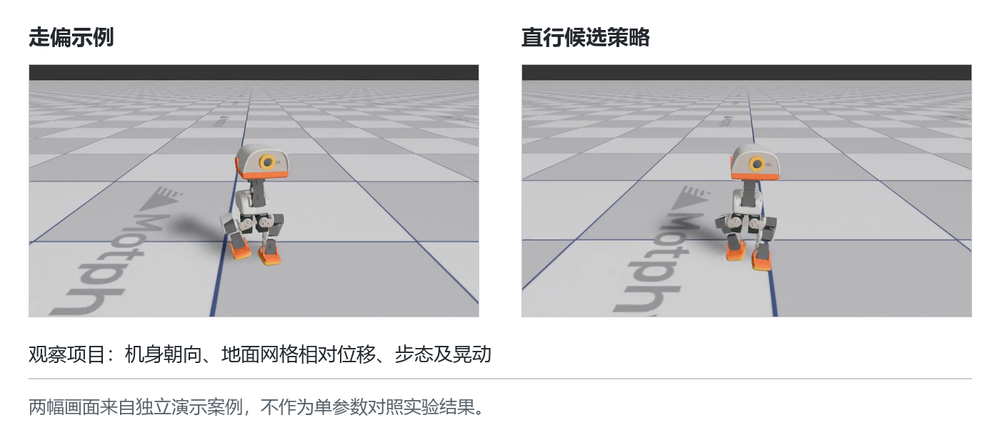

# MicroDuck × Motrix 行走强化学习工作坊

用 MotrixLab 训练 MicroDuck，在 MotrixSim 中观察行走。第一版提供两份教学模型、带中文注释的行走配置，以及修改参数、训练、回放和录制的统一入口。

## 教学资料

[教学方案与技术说明](docs/课堂讲义.md)包含教学安排、强化学习基础、平台分工、工程运行、参数实验与结果分析，配有 13 幅技术图示和真实仿真画面。人员分工、课前准备及待落实事项见[教学实施与保障方案](docs/教学实施与保障方案.md)。

环境配置、操作报错与训练结果说明见[常见问题与故障处理（FAQ）](docs/常见问题与故障处理.md)。

实际运行记录：[20 秒短训练回放](docs/media/本次短训练回放.mp4)。



## 环境检查与策略回放

在已完成课前环境准备的电脑上，从工程根目录打开 PowerShell，依次执行：

```powershell
.\tools\lesson.cmd check --brief
.\tools\lesson.cmd play --case drift
.\tools\lesson.cmd play --case straight
```

完成当前案例回放并关闭仿真窗口后，再执行下一条命令。`drift` 是走偏示例；`straight` 是直行候选，也是课堂续训的起始模型。

## 奖励参数对照实验

```powershell
notepad .\configs\walking_constraints.yaml
```

修改字段为 `task.rewards.penalty_heading_rate.weight`。A 组保留 `-20.0`，B 组改为 `-25.0`，其余参数保持一致。每组依次执行：

```powershell
.\tools\lesson.cmd train --steps 256 --constraints configs/walking_constraints.yaml --dry-run
.\tools\lesson.cmd train --steps 256 --constraints configs/walking_constraints.yaml --render
.\tools\lesson.cmd play-trained --latest
.\tools\lesson.cmd play-trained --latest --record --seconds 20
```

上述命令依次完成参数核对、训练、回放及视频保存。`256` 表示新增的并行采样循环数，用于验证操作流程。A 组完成并保存结果后，再执行 B 组实验。训练结果位于 `outputs/training_outputs/local_tutorial/`。

## 工程结构与核心算法

| 功能 | 文件或目录 |
| --- | --- |
| 全部行走约束与中文注释 | `configs/walking_constraints.yaml` |
| YAML 加载与任务配置 | `src/microduck_course/constraints.py` |
| 教学任务与航向变化率惩罚 | `src/microduck_course/task.py`、`heading_rewards.py` |
| 训练和回放适配 | `src/microduck_course/runtime.py` |
| FastSAC 的 Actor、Critic 与经验池 | `upstream/MotrixLab/motrix_rl_builtin/src/motrix_rl_builtin/fastsac/` |
| MicroDuck 的 MJCF、URDF、网格与关节表 | `models/microduck/` |
| 两份课堂模型及对应配置 | `policies/source_runs/` |
| 契约检查 | `checks/` |

## 课前环境准备

需要 Windows、Git for Windows 和 NVIDIA CUDA 运行条件。仓库不包含 Python 虚拟环境。固定版上游提供安装入口，在工程根目录运行：

```powershell
Push-Location .\upstream\MotrixLab
.\install.ps1 --python 3.12 --gpu cuda
Pop-Location
uv pip install --python .\upstream\MotrixLab\.venv\Scripts\python.exe -e .
.\tools\lesson.cmd check --brief
```

安装只在课前进行。若已有可用环境，可把 `COURSE_PYTHON` 指向该环境的 Python；否则入口按本工程 `.venv`、`upstream/MotrixLab/.venv` 的顺序查找。依赖版本参考 `environment/requirements-observed.txt`，它是本次运行环境的版本记录。

## 第一版状态与来源

算法为 FastSAC，最终行走画面由 MotrixSim 展示。直行候选的已有严格测试为六次通过五次，课堂实验继续比较方向、迈步和稳定性。第二引擎 Sim2Sim 尚待实测；本课不做 Sim2Real。

MotrixLab 固定提交为 `1ddb9743c220c3a1e234ea0237d5ce9cc56d0499`。上游代码、机器人模型各自的来源与许可见 [THIRD_PARTY_NOTICES.md](THIRD_PARTY_NOTICES.md)，发布快照说明见 [upstream/README.md](upstream/README.md)。本仓库未另行为用户自有代码指定开源许可证。
