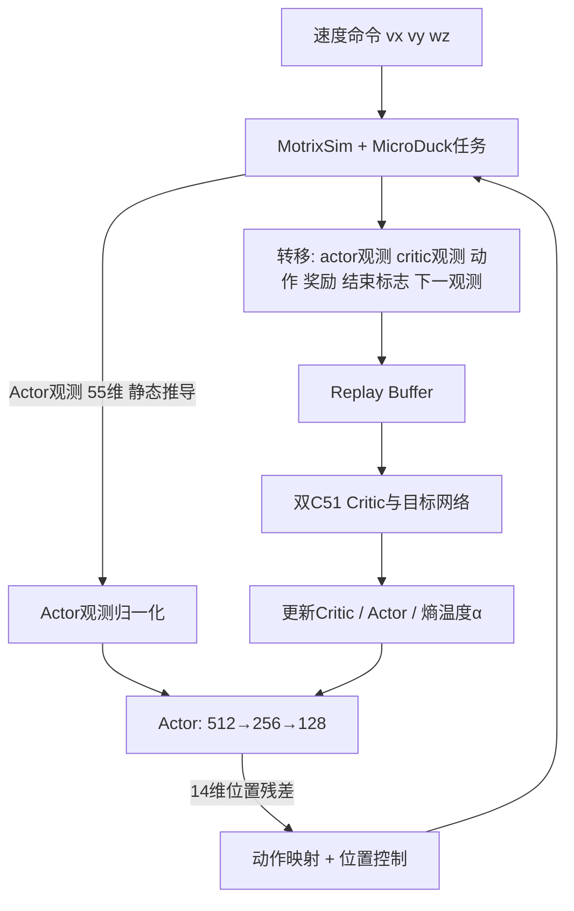
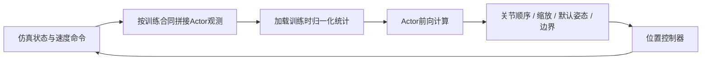

# 训练与推理结构：鸭子在学什么

## 一句话说明

给定期望行走速度，Actor 根据当前观测输出 14 个关节的位置残差。MotrixSim 推进动力学，奖励评价这一动作的结果。训练器用经历过的转移更新策略；回放时只做观测到动作的前向计算。

## 训练数据流



Critic 输入包括 Actor 没有的基座线速度。固定源码静态推导 Actor 55 维、Critic 58 维；实际运行验收要再次打印形状，不能只看图。Critic 还接收 14 维动作，其拼接输入共 72 维；两个 Q 网络各输出 101 个值分布原子的 logits。

训练的最小循环（教学伪代码，不是另一个可运行训练器）：

```python
obs_actor, obs_critic = env.reset()
while collecting:
    action = actor(normalize_actor(obs_actor)).sample()
    next_obs, reward, terminated, truncated = env.step(action)
    replay.add(obs_actor, obs_critic, action, reward, next_obs,
               terminated, truncated)
    batch = replay.sample()
    update_twin_critics(batch)
    update_actor_and_temperature_when_due(batch)
    soft_update_target_critics()
    obs_actor, obs_critic = next_obs
```

真实实现还处理非对称归一化、终止/时间截断、自举、混合精度、异步数据通信和检查点。课堂只需先理解数据为什么走这条路。

## Actor、Critic 与探索

Actor 是“下一步关节怎样摆”的决策网络。训练时输出高斯分布的均值和标准差，再经 tanh 与动作范围映射产生样本；不是把“向前走”直接翻译为预写关节动画。

Critic 是“当前动作对长期回报有多好”的训练工具。这里使用两个回报分布价值网络，C51 中的“分布”指回报的离散分布，不是多台服务器。“Fast”涉及工程吞吐改进，不改变 Actor 和环境之间的基本闭环。

SAC 将奖励和策略熵一起优化。熵允许探索；温度 α 控制这部分的相对权重。不要把高熵直接解释为好步态，也不要因价值损失下降就宣布行走成功。

## 推理 / 策略行走



推理不需要 Critic 或 Replay Buffer，但需要模型、Actor 权重、归一化统计、控制约定及版本标识。只有一个 ONNX/PT 文件不足以保证另一引擎能正确运行。

## 一次实验应该留下哪些证据

1. 配置快照：种子、动作变化惩罚倍数、实际奖励权重、资源规模。
2. 起点身份：从零还是教师 starter；起点检查点及其哈希。
3. 真训练记录：运行 ID、时间、日志、非空新检查点；dry-run 不属于训练。
4. 同条件结果：速度跟踪、跌倒或存活、动作变化和观察说明。
5. 推理身份：回放确实载入本人这次检查点，最终窗口为 MotrixSim。

**思考题：**如果训练时看起来在走，导出后鸭子却倒了，优先查什么？先查观测顺序/归一化、动作顺序/默认姿态、时间步与控制器，再查接触和物理参数；不要先归咎于网络太小。
