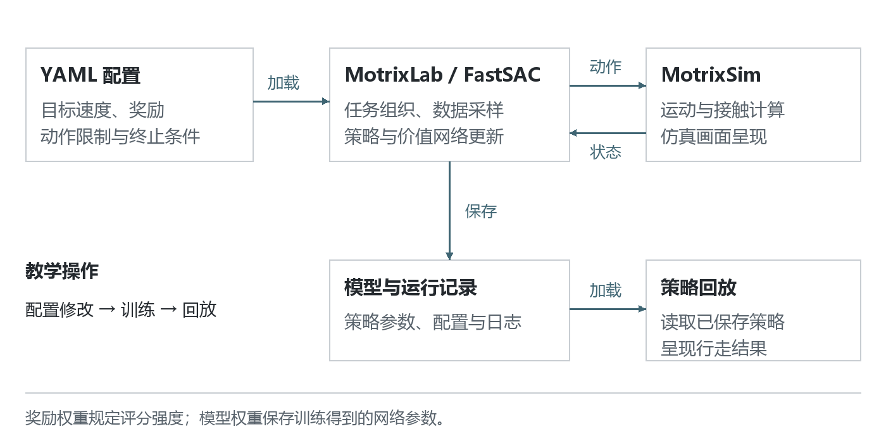
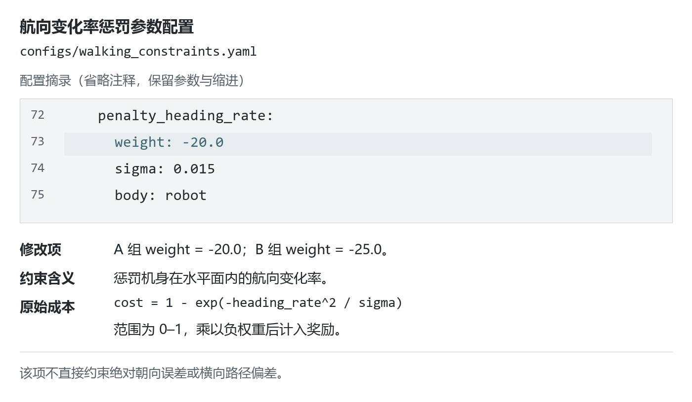
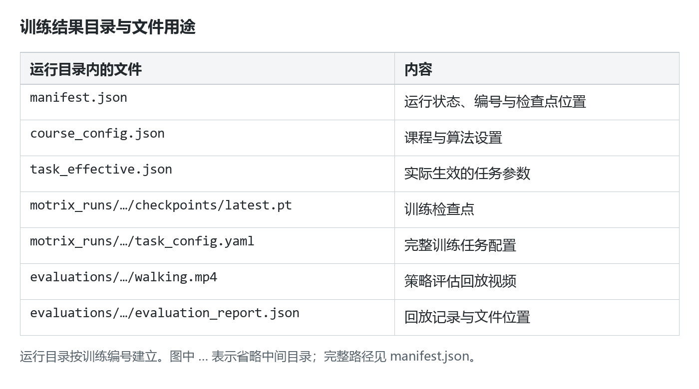

# 谋先飞仿真工作坊常见问题与故障处理

本文件为 MicroDuck 强化学习工作坊的常见问题解答（FAQ），配合《教学方案与技术说明》和《教学实施与保障方案》使用，供课前准备、课堂操作及技术答疑查阅。

适用版本：2026 年 11 月 16 日技术资料包 v1。课程使用 MotrixLab 训练、MotrixSim 仿真与回放，现场不安装环境，不开展 Sim2Real。

教学工程仓库：[NullCXX/microduck-motrix-workshop](https://github.com/NullCXX/microduck-motrix-workshop)。首版代码保留于 [v0.1.0](https://github.com/NullCXX/microduck-motrix-workshop/tree/v0.1.0)。

配套文档：[教学方案与技术说明](课堂讲义.md)、[教学实施与保障方案](教学实施与保障方案.md)。

## 一、平台与课程范围

### 1. MotrixLab、MotrixSim 与 MotrixStudio 的功能有何区别？

本课程使用 MotrixLab 组织训练任务，由 MotrixSim 计算物理运动并显示行走画面。运行现有工程不要求使用 MotrixStudio。

| 软件或文件 | 本课程中的作用 |
|---|---|
| MotrixLab | 调用任务与算法，采集训练数据，更新策略并保存结果 |
| MotrixSim | 计算机器人运动、地面接触并显示仿真画面 |
| MotrixStudio | 可作为补充介绍，尚未纳入本课程的必做操作与验收范围 |
| YAML 配置 | 设置速度指令、奖励、动作与终止条件 |
| 模型权重 | 保存训练得到的策略参数，供回放或继续训练使用 |



### 2. 本课程使用哪种机器人模型和强化学习算法？

当前工程使用 Pollen Robotics 的 MicroDuck 模型，共 14 个驱动关节，左右腿各 5 个，头颈共 4 个。算法为官方 MotrixLab 的 FastSAC，属于 SAC 算法路线。

Actor 根据观测生成关节动作，Critic 估计动作的长期收益，经验池保存机器人与环境交互的数据。核心实现位于 `upstream/MotrixLab/motrix_rl_builtin/src/motrix_rl_builtin/fastsac/`。详细原理与文件位置见《教学方案与技术说明》第三、七章。

### 3. 加载 URDF 后是否可以直接进行行走训练？

URDF 用于查看机器人结构。当前训练和策略回放使用 MJCF 模型，并依赖对应任务、观测顺序、动作顺序与模型权重。仅成功加载 URDF，不能证明行走策略已经运行。

模型资料位于 `models/microduck/`。其中 `urdf/microduck.urdf` 为结构描述，`mjcf/microduck.xml` 为仿真模型，`joint_map.yaml` 为关节映射。供应商改版机器人需另行核对模型、网格、关节范围、质量与惯量后适配。

### 4. 当前课程是否包含 Sim2Sim、实物部署和交互控制？

当前已整理的实践流程为策略回放、配置修改、短时续训和结果比较。第二物理引擎的 Sim2Sim 实测尚未完成。MotrixLab 训练与 MotrixSim 回放之间的衔接不属于跨引擎验证。

WASD 控制、鼠标施力或拖动、地形预设按钮尚未完成本课程验证。现场不开展 Sim2Real，两只实物机器人由主讲演示，学员不操作实物，也不在现场部署课堂训练策略。

## 二、环境准备与工程启动

### 5. 命令应在哪个目录执行？

使用完整资料包时，在 `03_教学工程` 文件夹中打开 PowerShell。使用 Git 仓库时，在仓库根目录打开 PowerShell。两种目录均应包含 `tools`、`configs`、`models` 等文件夹。

先执行环境检查：

```powershell
.\tools\lesson.cmd check --brief
```

检查输出用于确认实际 Python 路径、模型和必要依赖。通过后再进行策略回放。若提示无法找到 `lesson.cmd`，先检查终端当前目录和工程是否完整。

### 6. 是否需要在课堂安装 Python 或谋先飞软件？

不需要在课堂安装。教师与技术人员在课前准备环境，学员使用已配置的本地环境或云端实例。

Git 仓库不包含 Python 虚拟环境。首次部署按[工程 README 的课前环境准备说明](https://github.com/NullCXX/microduck-motrix-workshop#课前环境准备)操作，依赖版本参考 `environment/requirements-observed.txt`。该文件是教师电脑的实测版本记录，其他设备仍需验证兼容性。

准备完成后，依次验证环境检查、两份示例策略回放、短时训练、新结果回放和录像保存。环境检查通过不替代完整流程验证。

### 7. 出现“Prepared Python not found”应如何处理？

该提示表示启动器未找到已配置的 Python。先检查工程中的 `.venv/Scripts/python.exe` 或 `upstream/MotrixLab/.venv/Scripts/python.exe` 是否存在，再由技术人员确认依赖是否齐全。

如果已经激活课程环境，且终端中的 `python` 确实指向该环境，可在当前 PowerShell 中执行：

```powershell
$env:COURSE_PYTHON = (Get-Command python -CommandType Application -ErrorAction Stop).Source
.\tools\lesson.cmd check --brief
```

第一条命令将当前 Python 的实际路径交给启动器，第二条检查环境。若未配置课程环境，执行上述命令不会自动安装依赖。

公开仓库仅查找显式指定的 Python 和仓库内环境。本机资料包另有教师电脑环境的回退路径，该路径不能直接用于其他计算机。显式指定的 `COURSE_PYTHON` 无效时，启动器会报错，不自动切换到其他环境。

### 8. PowerShell 提示“& 后面的表达式生成无效的对象”是什么原因？

此前的 `& $py ...` 命令依赖提前给 `$py` 赋值。新终端中变量未设置时，PowerShell 无法确定需要执行的程序。

本课程使用以下入口，无需手动维护 `$py`：

```powershell
.\tools\lesson.cmd check --brief
```

若仍出现错误，保留完整命令和错误文字，按第 20 项反馈。现场由助教处理环境问题。

## 三、策略回放与状态判断

### 9. “走偏示例”“直行候选”和“本次训练结果”分别指什么？

| 名称 | 用途 | 运行入口 |
|---|---|---|
| 走偏示例 | 观察方向偏移，分析奖励设计的局限 | `play --case drift` |
| 直行候选 | 展示已有改进，并作为课堂续训的起始模型 | `play --case straight` |
| 本次训练结果 | 修改参数后实际生成的新模型 | `play-trained --latest` |

完整回放命令如下，完成当前案例并关闭仿真窗口后，再执行下一条：

```powershell
.\tools\lesson.cmd play --case drift
.\tools\lesson.cmd play --case straight
```

回放读取已保存的策略，不更新神经网络参数。执行训练命令后，程序才会采样并更新网络。

### 10. 直行候选是否已通过稳定行走验收？

尚未全部通过。已有记录为六次严格测试通过五次，其中一次最大朝向偏差约为 10.030128°，超过 10° 门槛，因此仍记录为未通过。

该模型可用于课堂观察和续训起点，正式冻结前仍需复测。短时间的视频展示不能代替完整稳定性验收，也不能据此保证任意随机种子下均能笔直行走。

### 11. 机器人跌倒后重新站立，是否说明学会了自主恢复？

不一定。任务结束后，仿真环境可能重置机器人并开始下一回合。判断恢复能力时，应结合回放日志确认是否发生重置。环境重置不属于机器人自主起身。

实验记录分别填写跌倒、终止和重置情况，避免将多个回合的画面合并描述为一次持续行走。

### 12. 命令执行后没有仿真窗口，应先检查什么？

先核对命令类型，再检查终端输出。

| 命令或参数 | 预期行为 |
|---|---|
| `check --brief` | 输出环境检查结果，不启动行走窗口 |
| `train ... --dry-run` | 预览训练计划，不训练、不生成新策略，也不启动训练窗口 |
| `train ... --render` | 执行训练并显示训练可视化，首次运行可能等待编译 |
| `play --case ...` 或 `play-trained --latest` | 启动策略回放窗口 |
| 回放命令加 `--record` | 直接生成视频，完成后查看终端给出的保存位置 |

如果命令确实要求打开窗口，检查终端是否仍在编译、已报错或提前结束。记录完整报错，由助教判断配置、模型或渲染问题。

## 四、参数配置与训练执行

### 13. 行走约束在哪里修改，修改后是否立即改变策略？

约束入口为 `configs/walking_constraints.yaml`，含速度指令、奖励、动作、终止条件、观测、随机扰动和仿真时间等中文注释配置。使用以下命令打开：

```powershell
notepad .\configs\walking_constraints.yaml
```

YAML 定义任务设置，模型权重保存已经学到的策略。修改 YAML 后，应使用新设置训练，再回放新模型。已有固定示例不会自动变成修改后的策略。

训练命令需显式指定 `--constraints configs/walking_constraints.yaml` 才会读取该文件。未指定时，使用固定起始任务及默认航向惩罚预设。`play-trained` 回放使用对应训练保存的配置，不受后续 YAML 编辑影响。

关节硬限位由 MJCF 模型提供，YAML 中相关条目为只读参考。并行环境数量、学习率和网络结构属于训练配置，不在这份行走约束文件中统一设置。



### 14. 本次实验修改哪个参数，应如何组织两组训练？

本次仅修改 `task.rewards.penalty_heading_rate.weight`。A 组使用 `-20.0`，B 组使用 `-25.0`，其他配置与新增采样循环数保持一致。

该参数惩罚机身水平航向变化率。负权重绝对值增大，表示惩罚增强。它不直接约束绝对朝向误差，可能减小转向，也可能抑制迈步，结论需以回放记录为依据。

每组按以下顺序操作：

1. 保存该组 YAML，核对缩进、字段及数值。
2. 执行预览，确认读取了目标配置。
3. 执行训练，保存运行编号。
4. 回放并保存结果，完成后再进行另一组。

```powershell
.\tools\lesson.cmd train --steps 256 --constraints configs/walking_constraints.yaml --dry-run
.\tools\lesson.cmd train --steps 256 --constraints configs/walking_constraints.yaml --render
.\tools\lesson.cmd play-trained --latest
```

默认续训从同一份固定课堂起始模型及其保存的训练状态开始，经验池重新采样。B 组不继承 A 组结果。本次对照实验不使用 `--from-scratch`。`--constraints` 不能与 `--yaw-weight` 同时使用。

### 15. “新增 256 次采样循环”代表什么，是否足够学会行走？

它表示本次训练新增 256 次并行采样循环，不是 256 个视频帧，也不是 256 次策略网络更新。当前配置每次循环由 512 个环境采样，因此产生 131072 条新的状态转移。

按当前配置，预计执行 192 次 Critic 更新和 48 次 Actor 更新，实际完成情况以本次日志为准。采样次数与网络更新次数分别统计，修改配置后应重新核对。

这组预算用于验证流程，不保证改善行走效果，也不代表从随机策略开始即可学会行走。正式课堂的训练预算需在课前按实际设备测时后确定。

### 16. 训练可视化启动后暂停约 20 秒，是否属于异常？

当前教学入口在首个采样步骤后预留约 20 秒，便于观察初始训练画面。这段停留不代表完整训练时长。首次运行还可能包含编译等待，应结合终端输出判断进度。

`--render` 显示训练中的探索动作，并记录对应可视化片段。训练画面中的抖动或跌倒不直接代表最终策略表现，完成训练后使用 `play-trained` 单独回放评估。

### 17. 修改参数后效果没有改善，应如何分析？

先核对本次配置是否实际生效，再比较动作表现。运行目录中的 `course_config.json` 记录读取的约束值，`task_effective.json` 记录实际任务设置。

两组应使用相同起始模型、训练预算、速度指令、测试种子与观察时长。分别记录前进、偏移、晃动、跌倒和停步情况。短时训练可能变化有限，也可能出现性能下降，保留原始结果和解释依据。

原走偏示例与直行候选来自不同历史训练设置，不作为本次单参数实验的因果证据。

## 五、结果保存与异常反馈

### 18. 新模型保存在哪里，是否会覆盖原有示例？

每次教程续训新建独立运行目录，位于 `outputs/training_outputs/local_tutorial/`。固定示例保存在 `policies/source_runs/`，不被教程续训覆盖。



| 文件或目录 | 保存内容 |
|---|---|
| `manifest.json` | 运行编号、完成状态和模型位置 |
| `course_config.json`、`task_effective.json` | 本次配置与实际生效参数 |
| `motrix_runs/` | 模型权重、任务配置和训练日志 |
| `evaluations/` | 训练后回放记录和视频 |

两组完整运行目录均需保留，不能只保存视频而丢失模型与配置。

### 19. `--latest` 选择哪次结果，如何保存和区分两组录像？

`play-trained --latest` 选择本教程中最近成功完成且模型有效的续训结果。失败记录和 `--from-scratch` 分支不属于该命令的选择范围。运行前核对终端显示的训练编号。

A 组完成后先执行以下命令保存 20 秒录像，再修改参数并训练 B 组：

```powershell
.\tools\lesson.cmd play-trained --latest --record --seconds 20
```

B 组完成后，`--latest` 通常指向 B 组。回放 A 组时，执行以下命令，并在提示后输入 A 组的完整训练编号：

```powershell
.\tools\lesson.cmd play-trained --run (Read-Host '请输入完整训练编号')
```

若提示没有可用结果，检查训练是否成功结束、模型文件是否仍存在，以及当前使用的是否为保存该结果的工程目录。

### 20. 遇到异常时需要提供哪些信息？

提交完整命令、终端末尾错误文字、预期行为和实际现象。已经开始训练时，补充运行编号或结果目录。截图应包含报错内容，账号密码不纳入反馈资料。

| 现象 | 优先检查 | 处理方式 |
|---|---|---|
| 无法找到 `lesson.cmd` | 终端目录与工程完整性 | 返回资料包的工程目录或仓库根目录 |
| `Prepared Python not found` | 已准备环境及 `COURSE_PYTHON` | 按第 7 项检查，由技术人员确认环境 |
| `No module named ...` | 当前解释器和课前依赖 | 保留环境检查输出，由助教处理 |
| YAML 读取失败 | 缩进、字段及参数值 | 按错误位置检查，修正后先执行预览 |
| 训练完成但回放选错结果 | 当前工程、运行编号和 `--latest` | 核对编号，必要时指定对应运行 |

课堂问题先由助教接收，主讲处理共性技术问题并按议程授课。现场不临时安装或升级依赖。

## 六、云端接入与资料使用

### 21. 同一教师镜像能否供 50 人同时使用？

教师镜像可以作为统一环境模板，但学员需要各自可写的实例、训练进程和结果目录。50 人成功登录不等于 50 人可以同时独立训练。

目前本地工程运行结果不能作为云端容量验收依据。需与平台方确认资源配额、图形访问、文件隔离及断线恢复，并在 RoboGo 和备用平台分别完成实际负载验证。云端镜像接入与 50 人独立训练尚待验证。

### 22. RoboGo 无法使用时如何安排？

原定备用平台为算力自由，两套平台均需在课前准备足额账号并验证登录和任务运行。使用备用平台前，应先确认对应环境可用，不能现场临时开通后直接视为完成准备。

云端服务整体中断时，主讲使用本地 MotrixSim 和预录视频继续教学，学员开展参数与结果分析。两只实物设备故障时，使用主讲课前保存的实物行走录像。

### 23. FAQ 与其他交付材料分别如何使用？

FAQ 用于查找具体问题。完整操作顺序和原理见《教学方案与技术说明》，人员分工、教学时间和课前安排见《教学实施与保障方案》。代码与模型通过 Git 仓库取得。

| 资料 | 访问入口 |
|---|---|
| 教学方案与技术说明 | [仓库文档](课堂讲义.md) |
| 教学实施与保障方案 | [仓库文档](教学实施与保障方案.md) |
| 教学工程与 README | [GitHub 仓库](https://github.com/NullCXX/microduck-motrix-workshop) |
| 模型资产 | [MicroDuck 模型目录](https://github.com/NullCXX/microduck-motrix-workshop/tree/main/models/microduck) |
| 实际短训练回放 | [20 秒回放视频](https://github.com/NullCXX/microduck-motrix-workshop/blob/main/docs/media/本次短训练回放.mp4) |

本 FAQ 随工程版本更新，12 月 4 日与 Demo、代码及其他教学材料同步冻结。
