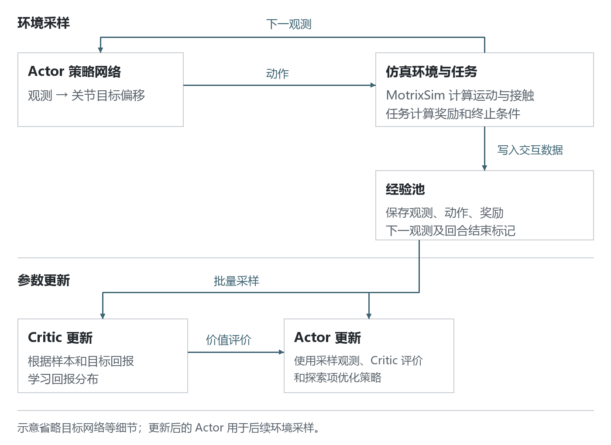
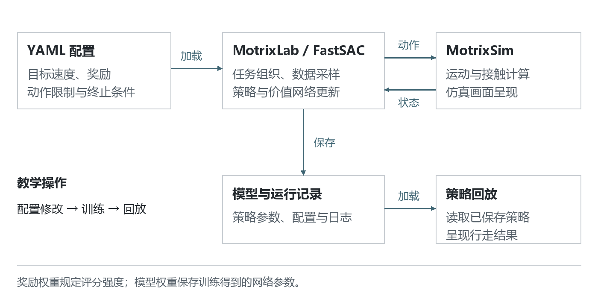
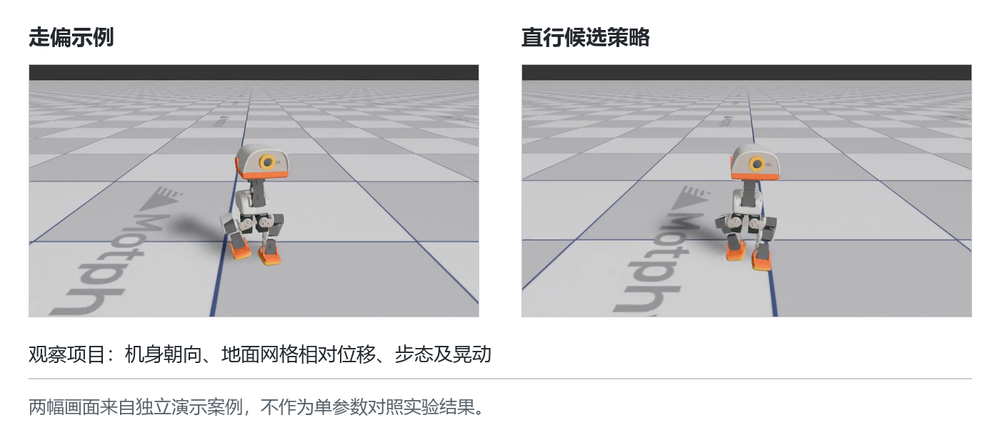
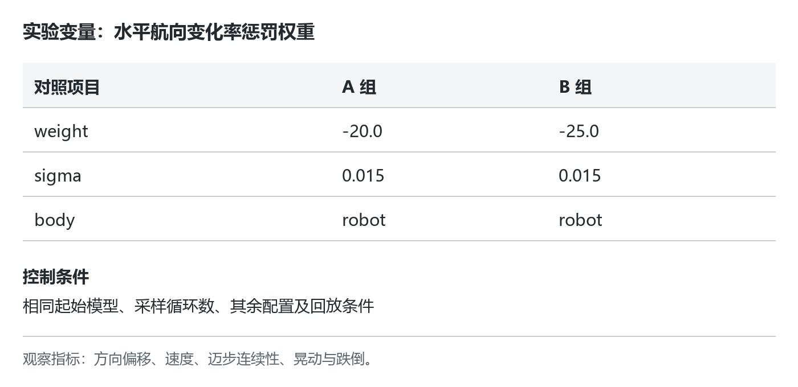
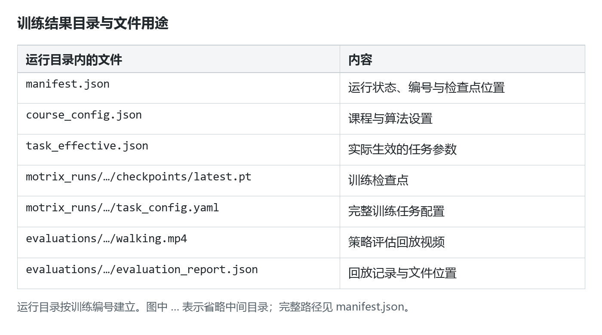

# 谋先飞仿真工作坊教学实施与保障方案

活动名称：谋先飞仿真工作坊｜基于 MotrixLab 的强化学习任务实践。

活动时间与地点：2026 年 12 月 6 日，上海张江科学会堂。

教学工程仓库：[NullCXX/microduck-motrix-workshop](https://github.com/NullCXX/microduck-motrix-workshop)

首版代码：[v0.1.0](https://github.com/NullCXX/microduck-motrix-workshop/tree/v0.1.0)。仓库包含课程代码、MicroDuck 模型、行走策略、中文约束配置及训练与回放入口。

## 一、教学目标与实施范围

本工作坊以 MicroDuck 双足机器人（小鸭子）行走任务为载体，面向具有一定技术基础的学员，介绍强化学习原理并开展奖励参数对照实验。教学目标为完成参数修改、短时训练、结果回放与比较，形成包含配置、模型及实验记录的学习成果，并说明参数调整依据与实际效果。

教学采用 FastSAC 算法，由 MotrixLab 组织训练，在 MotrixSim 中呈现行走仿真画面。运行环境在课前准备，现场不安装环境；实物环节由主讲操作两只机器人进行展示，本次活动不开展 Sim2Real。

## 二、教学安排

| 时间 | 实施内容 |
|---|---|
| 12:00–13:30 | 工作人员到场，检查投影、网络、账号、工程及实物演示区域 |
| 13:30–14:00 | 签到、入座及课堂环境接入 |
| 14:00–14:10 | 行走示例展示、MicroDuck 介绍及教学任务说明 |
| 14:10–14:40 | 强化学习基础：观测、动作、奖励、Actor、Critic 与经验池 |
| 14:40–14:55 | MotrixSim、MotrixLab 功能介绍及配置、日志、结果目录说明 |
| 14:55–15:15 | 走偏示例与直行候选策略回放、现象记录 |
| 15:15–15:25 | 休息，助教处理接入及运行问题 |
| 15:25–16:00 | 两组参数配置、短时续训及结果保存 |
| 16:00–16:45 | 训练模型回放、结果比较与原因分析 |
| 16:45–17:00 | 实验结论交流与资料整理 |
| 17:00–17:30 | 主讲开展两只实物机器人的行走演示及现场交流 |
| 17:30–18:00 | 设备与物料整理、清场 |

## 三、教学内容与组织方式

### 1. 机器人介绍与强化学习基础

课程以行走画面展示开始，介绍腿部结构、关节与控制任务。通过讨论关节动作如何确定，引入观测与动作概念，将理论与机器人控制过程对应。

奖励设计环节围绕单一速度奖励可能引起的行为偏差展开讨论，引导学员分析姿态、抖动和跌倒等问题，再说明多项奖励之间的取舍。FastSAC 介绍包括三个重点：Actor 生成动作，Critic 估计长期收益，经验池保存交互数据供训练重复采样。

### 2. 平台功能与工程结构

平台介绍按仿真窗口、`configs/walking_constraints.yaml`、训练日志和结果目录的顺序展开。主讲通过投影展示各位置，学员同步定位对应内容，并确认模型、配置与权重文件的存储位置。

### 3. 示例策略观察

两个示例回放后预留一分钟观察时间，组织学员描述行进方向、晃动与速度变化，并记录触地后的任务重置情况。完成现象记录后进入参数实验。

### 4. 参数对照实验

实验仅调整机身水平航向变化率惩罚权重：A 组为 `-20`，B 组为 `-25`。两组采用相同起始模型、训练次数及其他配置。训练前记录预期，重点分析提高惩罚强度是否减小水平航向变化率，以及是否同时抑制迈步。

短时训练预算根据课前测时统一确定，课堂操作包括配置修改、训练执行、结果保存及回放。

### 5. 结果分析与资料归档

结果比较统一速度指令、测试种子与回放时长。交流环节分别选取符合预期和变化不明显或出现其他性能下降的结果，要求学员说明参数调整、实际现象与解释依据。

结束前预留文件保存时间，归档两组配置、运行编号、模型、日志和回放视频，保留完整运行文件夹。

## 四、人员分工与现场保障

主讲负责授课、技术演示及活动当天的技术问题，讲课期间留在讲台。助教优先受理学员问题，记录完整命令与报错信息，共性问题由主讲集中说明。

现场执行人员共两人：一人负责签到、入座、网络协调、饮水和物料，另一人负责拍摄；工作集中时相互补位。助教人员另行落实。

个别学员运行失败时，由助教处理，课程继续。RoboGo 无法使用时切换至算力自由；云端服务整体中断时，主讲使用本地 MotrixSim 和预录视频继续教学，学员开展参数与结果分析。

实物环节的两只机器人由主讲携带并操作，学员仅观察。活动前分别完成一次行走测试，录像保存在主讲电脑，作为现场设备故障时的备用材料。

## 五、课前准备与版本冻结

12 月 4 日冻结 Demo、代码、PPT、实践手册、README 和 FAQ。主讲使用冻结版本完整执行课程操作，记录首次启动、两组短时训练及回放用时，检查投影字号和命令显示效果。

主讲电脑保存工程、示例视频、实物录像和离线材料。12 月 5 日仅核对资料、账号及备份，不安排现场彩排。技术负责人承担筹备和技术验收工作，活动当天可不到场。

## 六、待落实事项

| 事项 | 当前状态与后续工作 |
|---|---|
| 平台容量与账号 | RoboGo 和算力自由各准备不少于最终名单人数的账号。50 人独立修改代码、训练及仿真的并发能力待压测，同时检查目录隔离、结果保存与断线恢复。 |
| 策略复测与训练预算 | 直行候选策略现有六次严格测试通过五次，需继续复测后确定课堂起始文件，并确认课堂训练预算。 |
| Sim2Sim | 第二仿真引擎实测尚未完成。若冻结前完成，可纳入结果对比环节；否则使用 MotrixSim 比较两组策略。 |
| 模型资产与授权 | 确认网格资产的活动使用及分发授权。若采用供应商改版机器人，需补齐模型、网格和关节参数后开展适配。 |
