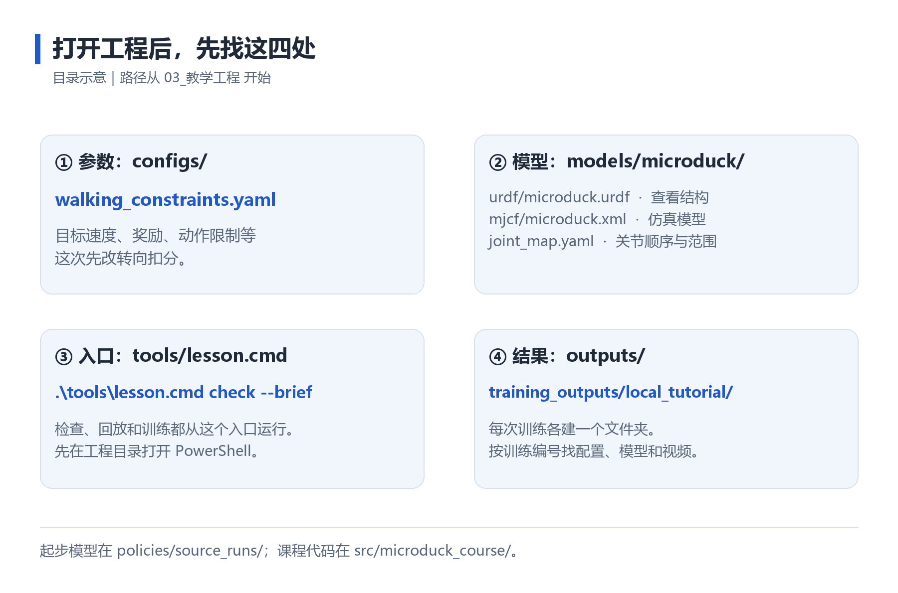
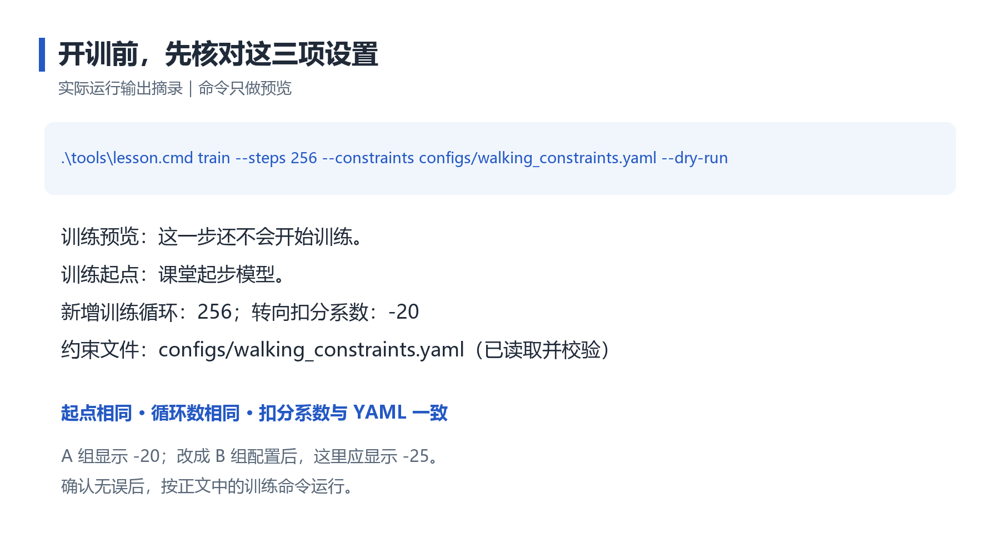
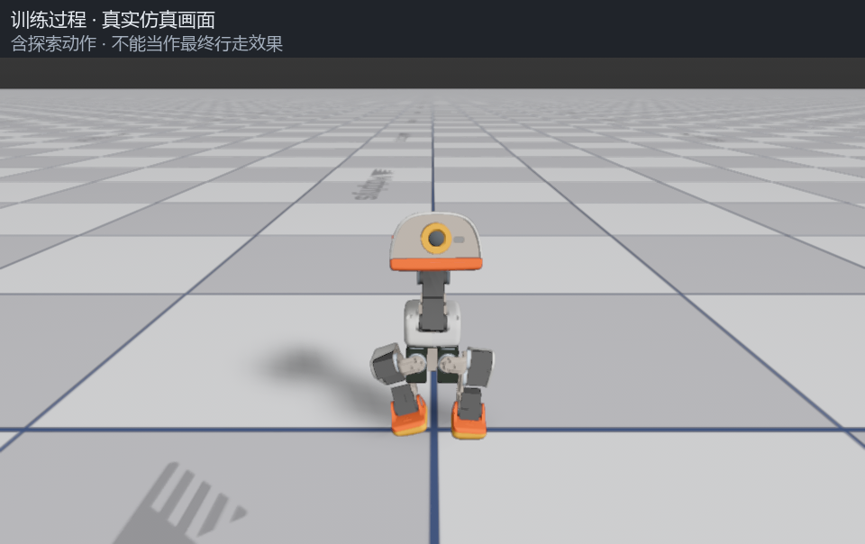
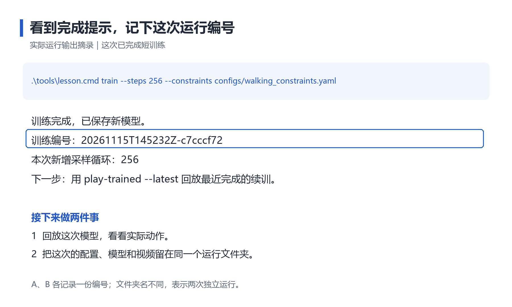
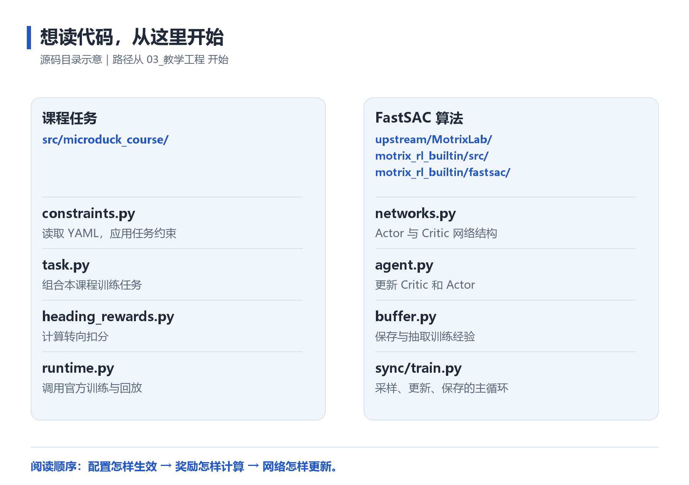

# 小鸭子强化学习工作坊｜课堂讲义

从 GitHub 获取工程时，图中的 `03_教学工程` 对应仓库根目录；先按 [README](../README.md) 准备环境，再运行讲义命令。

这次用谋先飞的 MotrixLab 和 MotrixSim，带大家跑通小鸭子行走，再改一个奖励参数，训练并比较结果。

时间：2026 年 12 月 6 日，14:00–17:00。地点：上海张江科学会堂。13:30 开始签到，17:00–17:30 由老师演示两只实物小鸭子。

## 一、今天怎么上

| 时间 | 内容 |
|---|---|
| 14:00–14:40 | 认识小鸭子，理解强化学习怎样用来学走路 |
| 14:40–14:55 | 认识 MotrixLab、MotrixSim，找到配置和结果目录 |
| 14:55–15:15 | 播放走偏示例和直行候选，记录看到的现象 |
| 15:15–15:25 | 休息，处理运行问题 |
| 15:25–16:00 | 只改转向扣分，完成两组短训练 |
| 16:00–16:45 | 回放自己的模型，比较走路效果 |
| 16:45–17:00 | 整理结果，分享发现 |

环境在课前统一准备，现场直接打开工程。遇到运行问题先找助教，老师继续讲解。实物演示由老师操作，课堂训练结果保存在仿真工程中。

## 二、小鸭子和软件分别做什么

课程模型是 Pollen Robotics 的 MicroDuck，有 14 个驱动关节：左右腿各 5 个，头颈共 4 个。走路时，策略根据机身和关节的状态，连续给出下一步的关节位置目标。

| 名称 | 这节课用它做什么 |
|---|---|
| MotrixLab | 组织训练任务，调用算法，保存日志和模型 |
| MotrixSim | 计算机器人与地面的运动和接触，显示小鸭子行走 |
| YAML 配置 | 设置目标速度、动作幅度、奖励和回合结束条件 |
| 模型权重文件 | 保存策略已经学到的控制方式，供回放或继续训练 |


打开工程后，先认清四处：仿真窗口看动作，`configs` 改参数，终端看运行进度，`outputs` 找结果。我们最终看到的行走画面来自 MotrixSim。

小鸭子的模型资料在 `models/microduck/`：`urdf/microduck.urdf` 用来查看结构，`mjcf/microduck.xml` 保存原生仿真模型，`joint_map.yaml` 列出了关节顺序、角度范围和默认站姿。

## 三、强化学习怎样让它走起来

机器人每次做动作前，先读取当前状态；动作执行后，环境给出下一状态和奖励。训练不断重复这个过程，让策略逐渐找到收益更高的动作。

| 概念 | 放到小鸭子身上怎么理解 |
|---|---|
| 观测 | 机身有没有倾斜、关节在哪、正在往哪转，以及目标速度是多少 |
| 动作 | 给 14 个关节的位置目标偏移，让腿和机身配合运动 |
| 奖励 | 跟上速度、保持稳定、按节奏迈步可以加分；晃动、转偏或动作突变会扣分 |
| 回合 | 从初始站姿开始，到碰撞或时间用完的一次尝试 |

本工程用 FastSAC。Actor 根据观测选动作；Critic 估计这个动作以后能带来多少收益；经验池保存之前的尝试，训练时再抽出来学习。Actor 既要争取更高收益，也保留一定探索，避免过早只会重复一种动作。


奖励函数是我们写的评分规则，Critic 是通过训练学出来的评价网络。比如“转得太快要扣分”由奖励函数定义，Critic 再学习这种动作对后续收益有什么影响。

策略每秒给出 50 次动作，物理仿真在两次动作之间继续计算运动。策略输出经缩放后成为关节位置目标，机器人便会一小步一小步地移动。训练画面中出现摔倒很常见；任务重置后，它会从初始姿态重新尝试。

今天改的是 YAML 里的奖励权重，也就是评分的轻重。神经网络的权重由训练程序更新，保存在模型文件中。所以改完 YAML，还要训练一次，再看新模型的动作。

设计奖励时，要想清楚希望机器人怎么完成任务。只追求速度，可能走得快却晃得厉害；过分强调动作平滑，也可能让它不愿迈步。我们给多个行为评分，是为了在前进、平衡和动作变化之间找到合适的配合。看到一个结果变好时，也看看其他方面有没有付出代价。

## 四、打开工程，先看它怎么走

### 1. 找到工程目录

进入资料包的 `03_教学工程` 文件夹，在空白处右键，选择“在终端中打开”，使用 PowerShell。下面的命令都在这里逐条运行。



### 2. 检查环境

先检查环境和模型文件：

```powershell
.\tools\lesson.cmd check --brief
```


看到“环境检查通过，可以运行小鸭子”后，再往下做。

### 3. 播放两个示例

先播放走偏示例：

```powershell
.\tools\lesson.cmd play --case drift
```

观察它是否一直向前、偏向哪边、有没有明显晃动。可以借地面网格判断方向变化。关掉窗口，再播放直行候选：

```powershell
.\tools\lesson.cmd play --case straight
```


直行候选是接下来练习的起步模型，目前仍有少数测试出现方向偏移。先记下自己的观察：它是更直了，还是只是速度变了？迈步是否连续？摔倒后有没有重置？

回放和训练是两个独立操作。回放读取已经保存的模型，你可以反复播放同一个结果；训练会继续采集经验，得到另一份模型。文件夹里有结果但窗口没打开时，先核对自己执行的是播放命令还是训练预览命令。

## 五、只改一个参数，再训练

这次比较两组：A 保留原来的转向扣分，B 把扣分加重。两组都从同一个课堂起步模型开始，训练相同的采样次数。


### 1. 找到要改的参数

打开配置文件：

```powershell
notepad .\configs\walking_constraints.yaml
```

搜索 `penalty_heading_rate`，会看到这一段：

```yaml
penalty_heading_rate:
  weight: -20.0
  sigma: 0.015
  body: robot
```


先保留 `weight: -20.0`，按下面的步骤完成 A 组。之后只把这个值改成 `-25.0`，保存，再跑一次作为 B 组。其余行和缩进保持原样。

这个参数对转向速度扣分。改得更负，小鸭子会更在意少转向，但也可能不愿迈步。训练前先写下你的预测，回放时再找证据。

同一份 YAML 里还可以找到目标速度、参考抬脚高度和动作变化扣分。例如 `feet_phase.swing_height` 是参考抬脚高度，单位为米；`penalty_action_rate.weight` 决定相邻动作变化太大时扣多少分。这次先保留这些值，完成方向实验后再选下一项，否则很难判断变化来自哪里。

### 2. 预览本次设置

保存 YAML 后运行：

```powershell
.\tools\lesson.cmd train --steps 256 --constraints configs/walking_constraints.yaml --dry-run
```



终端会显示起步模型、新增采样循环数和转向扣分系数。检查系数是否与刚保存的一致。

### 3. 开始训练

核对无误后运行：

```powershell
.\tools\lesson.cmd train --steps 256 --constraints configs/walking_constraints.yaml --render
```

`--constraints` 指定这次使用的配置，`--render` 打开训练画面。`--steps 256` 表示新增 256 次并行采样循环，先用它走通操作流程；课堂的训练预算由老师统一安排。



窗口刚启动时会停留约 20 秒，首次运行还可能等待编译。训练中看终端是否继续更新；出现“训练完成，已保存新模型”后，记下训练编号。A 组完成后先保存回放，再修改参数做 B 组。



报错时先停在当前步骤，把完整命令和终端最后几行交给助教。配置报错通常可以从提示中的字段名开始找；如果是文件找不到，先看终端是否仍在 `03_教学工程` 目录。暂时不用重新安装软件。

想换一个参数继续做实验，就回到这一步。每次运行都会新建结果目录，并重新从课堂起步模型出发。

## 六、回放、比较和保存

### 1. 回放自己的模型

播放最近完成的一次训练：

```powershell
.\tools\lesson.cmd play-trained --latest
```


[查看这次短训练的 20 秒回放](media/本次短训练回放.mp4)。这是完成操作后的一个真实结果，可用来观察动作和保存流程。

核对终端显示的训练编号，再看动作。比较时两组使用相同的目标速度和观察时长，记录前进、走偏、抖动和摔倒情况。短训练后的变化可能很小，也可能变差，把实际现象记下来即可。

观察时尽量把描述写具体：向左逐渐偏离、几秒后停住、迈步比之前小。只有目测就写目测，距离和角度经过测量后再填数值。想进一步检查稳定性，课后再用更多测试种子复测。

### 2. 保存视频和结果

保存 20 秒回放视频：

```powershell
.\tools\lesson.cmd play-trained --latest --record --seconds 20
```

这次直接生成视频，完成后终端会显示保存位置。训练结果在 `outputs/training_outputs/local_tutorial/` 下，每次一个文件夹。


| 留下的文件 | 用途 |
|---|---|
| `manifest.json` | 查本次运行编号、完成状态和模型位置 |
| `course_config.json`、`task_effective.json` | 查这次真正使用的配置 |
| `motrix_runs/` | 保存模型权重、任务配置和训练日志 |
| `evaluations/` | 保存回放记录和视频 |

把两组完整的运行文件夹一起留好。B 组完成后，`--latest` 会指向 B；需要重播 A 时，使用 `play-trained --run` 加上 A 的完整训练编号。

| 记录项 | A 组 | B 组 |
|---|---|---|
| 转向扣分 | -20.0 | -25.0 |
| 新增采样循环数 |  |  |
| 训练编号 |  |  |
| 前进和走偏情况 |  |  |
| 晃动、摔倒或停步情况 |  |  |
| 回放视频位置 |  |  |

最后写三句话：改了哪个参数；看到了什么变化；接下来想验证什么。评价奖励项的作用时，要比较这两组同条件实验。前面的两个教学示例用于认识现象。

## 七、想继续看代码，从这里找

以下路径都从 `03_教学工程` 开始。



| 想看什么 | 文件 |
|---|---|
| 中文行走约束 | `configs/walking_constraints.yaml` |
| YAML 怎样进入训练任务 | `src/microduck_course/constraints.py` |
| 教学任务怎样组合 | `src/microduck_course/task.py` |
| 转向扣分怎样计算 | `src/microduck_course/heading_rewards.py` |
| 怎样调用官方训练和回放 | `src/microduck_course/runtime.py` |

FastSAC 的算法文件在 `upstream/MotrixLab/motrix_rl_builtin/src/motrix_rl_builtin/fastsac/` 中：

| 文件 | 主要内容 |
|---|---|
| `networks.py` | Actor 和 Critic 的网络结构 |
| `agent.py` | 更新网络；先看 `_critic_backward`、`_actor_backward` 和 `update` |
| `buffer.py` | 保存、抽取训练经验 |
| `sync/train.py` | 采样、更新和保存模型的主循环 |

读代码可以从“配置怎样生效”开始，再往下看奖励函数和算法更新。当前 FastSAC 的 Critic 预测回报分布；Actor 按 Critic 的评价与探索项更新动作选择。想核对一次训练到底用了哪些算法参数，打开该次结果中的 `motrix_runs/.../task_config.yaml`，查看 `algo` 段。
