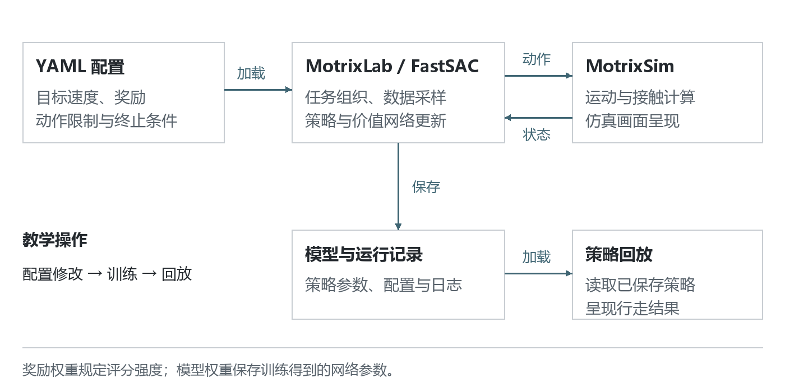
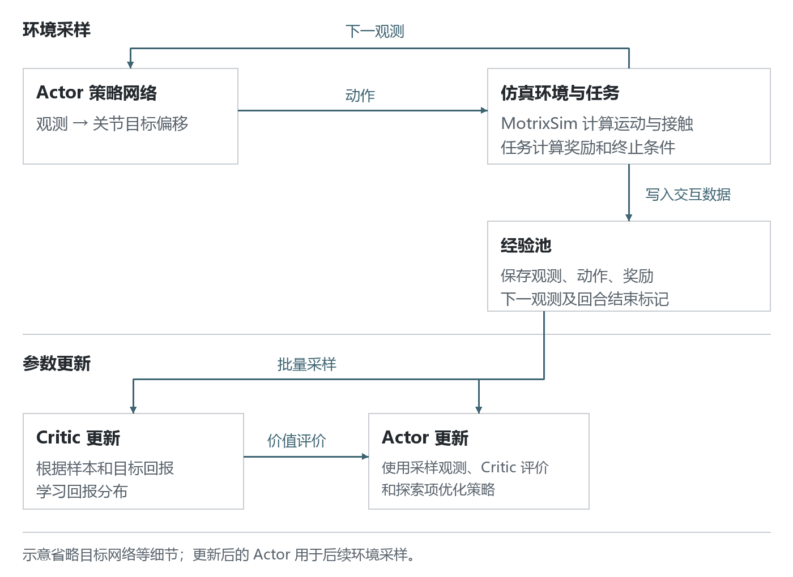
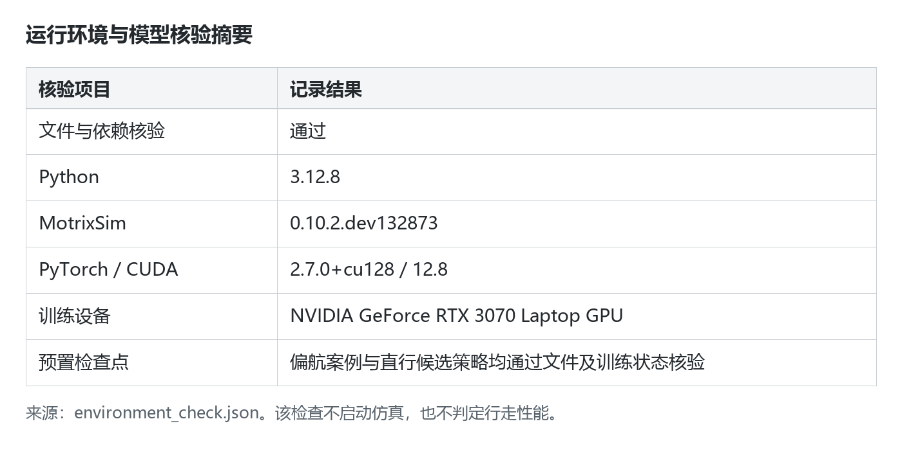
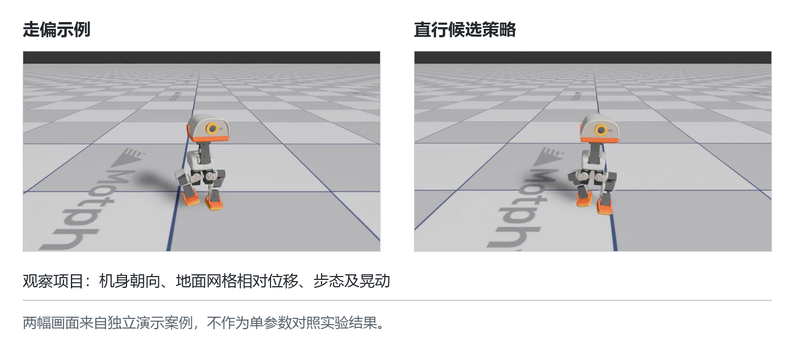
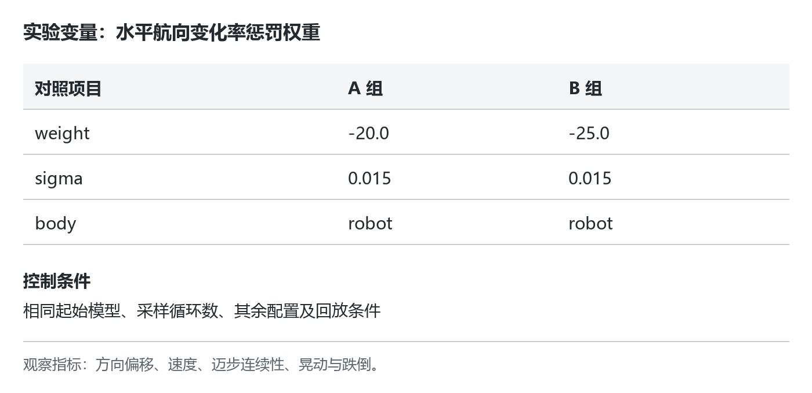
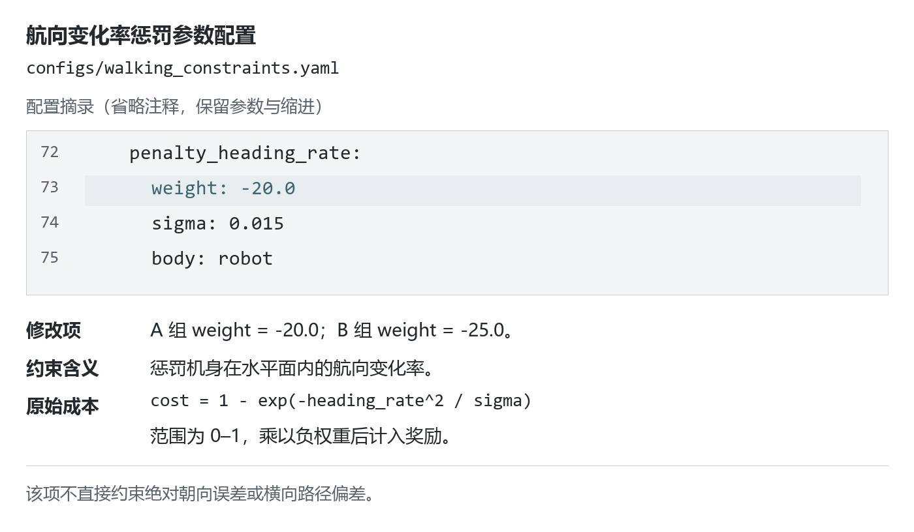
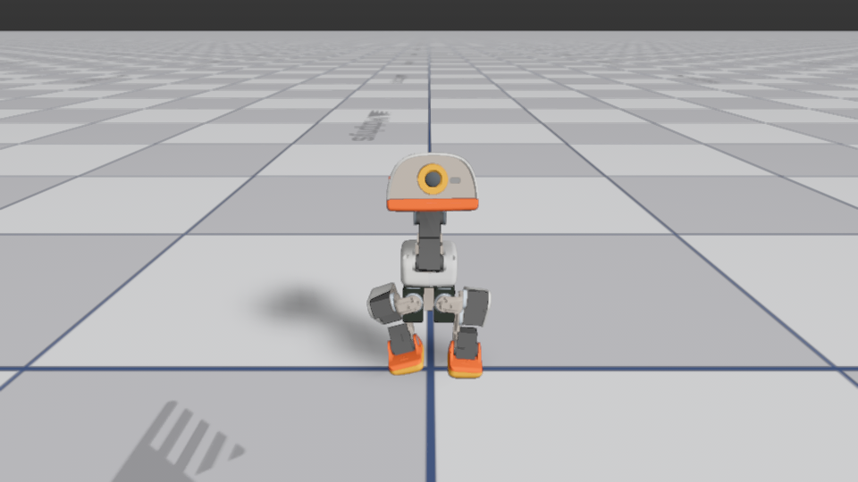
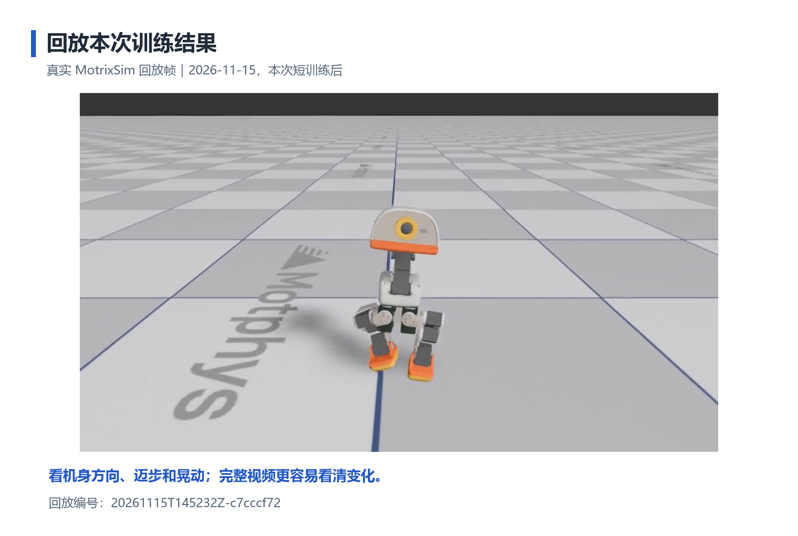
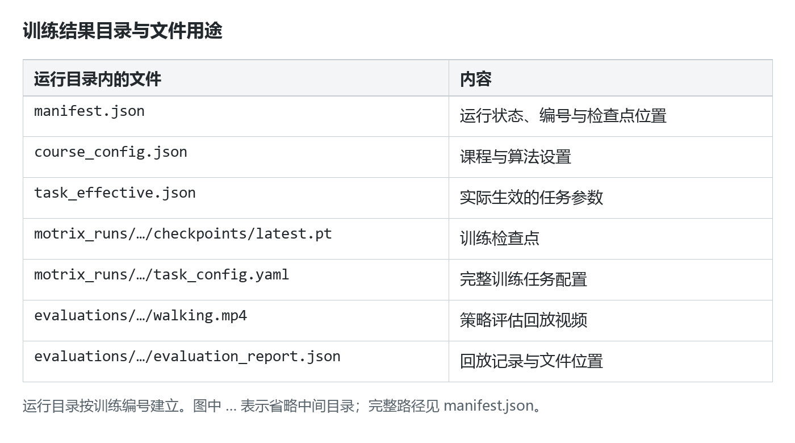

# 谋先飞仿真工作坊教学方案与技术说明

本工作坊以 Pollen Robotics 的 MicroDuck 双足机器人（小鸭子）为教学对象，使用谋先飞 MotrixLab 与 MotrixSim 开展强化学习行走实践。教学内容包括强化学习基础、平台功能、策略回放、奖励参数调整、训练及结果分析。

活动时间为 2026 年 12 月 6 日，地点为上海张江科学会堂。13:30 开始签到，14:00–17:00 开展课程教学，17:00–17:30 由主讲进行两只实物机器人的行走演示。

教学工程仓库：[NullCXX/microduck-motrix-workshop](https://github.com/NullCXX/microduck-motrix-workshop)

首版代码：[v0.1.0](https://github.com/NullCXX/microduck-motrix-workshop/tree/v0.1.0)。仓库包含课程代码、MicroDuck 模型、行走策略、中文约束配置及训练与回放入口。

## 一、教学安排

| 时间 | 教学内容 |
|---|---|
| 14:00–14:40 | MicroDuck 结构介绍与强化学习行走基础 |
| 14:40–14:55 | MotrixLab、MotrixSim 功能介绍及工程目录说明 |
| 14:55–15:15 | 走偏示例与直行候选策略回放、现象记录 |
| 15:15–15:25 | 休息及运行问题处理 |
| 15:25–16:00 | 航向变化率惩罚权重对照实验及两组短时训练 |
| 16:00–16:45 | 训练结果回放与行走效果比较 |
| 16:45–17:00 | 实验记录整理与结果交流 |

运行环境在课前统一准备，现场不安装环境。学员运行问题由助教优先处理，主讲按课程安排继续授课。实物演示由主讲操作，学员不操作实物机器人；课堂训练结果保存在仿真工程中，本次活动不开展 Sim2Real。

## 二、机器人模型与平台分工

MicroDuck 配有 14 个驱动关节：左右腿各 5 个，头颈共 4 个。行走策略根据机身与关节状态，连续输出关节位置目标。

| 组成 | 功能 |
|---|---|
| MotrixLab | 组织训练任务、调用算法、保存日志和模型 |
| MotrixSim | 计算机器人与地面的运动及接触，呈现行走仿真画面 |
| YAML 配置 | 设置目标速度、动作幅度、奖励及回合终止条件 |
| 模型权重文件 | 保存策略参数，用于回放或继续训练 |



工程的主要操作位置包括仿真窗口、配置目录 `configs`、运行终端和结果目录 `outputs`，分别用于动作观察、参数修改、进度查看和结果管理。最终行走画面通过 MotrixSim 展示。

机器人模型资料位于 `models/microduck/`：`urdf/microduck.urdf` 用于结构查看，`mjcf/microduck.xml` 为原生仿真模型，`joint_map.yaml` 记录关节顺序、角度范围和默认站姿。

## 三、强化学习基础

强化学习通过机器人与环境的持续交互优化控制策略。策略读取当前状态并输出动作，环境执行动作后返回下一状态与奖励，训练程序据此更新策略。

| 概念 | 行走任务中的含义 |
|---|---|
| 观测 | 机身姿态、关节状态、转向状态及目标速度等信息 |
| 动作 | 14 个关节的位置目标偏移，用于协调腿部与机身运动 |
| 奖励 | 对速度跟踪、稳定性及步态节奏给予奖励，对机身晃动、水平航向变化率及动作突变施加惩罚 |
| 回合 | 从初始站姿开始，至碰撞或时间限制触发终止的一次任务过程 |

工程采用 FastSAC 算法。Actor 根据观测生成动作；Critic 估计动作对应的长期收益；经验池保存交互数据，供训练重复采样。Actor 的优化同时考虑收益与探索，降低策略过早收敛至单一行为的可能性。



奖励函数与 Critic 的作用不同：奖励函数定义行为的评分规则，Critic 通过训练估计后续收益。例如，机身水平航向变化率惩罚由奖励函数计算，Critic 学习该行为对长期收益的影响。

策略输出频率为每秒 50 次。两次策略输出之间，物理仿真继续计算机器人运动；策略输出经缩放后转换为关节位置目标。训练过程中可能出现跌倒，任务重置后机器人从初始姿态重新执行任务。

实验修改对象为 YAML 中的奖励权重，用于调整各项评分的相对强度。神经网络权重由训练程序更新并写入模型文件，因此配置修改后需重新训练，再通过回放分析动作变化。

奖励设计需兼顾前进速度、姿态稳定性与动作平滑性。过度强调速度可能增加晃动，过度强调动作平滑可能抑制迈步。结果分析应同时检查目标行为改善与其他指标变化。

## 四、工程运行与策略回放

### 1. 工程入口

运行目录为本仓库根目录。在该文件夹空白处右键选择“在终端中打开”，使用 PowerShell 执行本节及后续命令。


### 2. 环境检查

环境与模型文件检查命令如下：

```powershell
.\tools\lesson.cmd check --brief
```



环境检查通过后，执行策略回放。

### 3. 示例策略回放

走偏示例回放命令如下：

```powershell
.\tools\lesson.cmd play --case drift
```

观察内容包括前进方向、偏转方向与机身晃动，可通过地面网格辅助判断方向变化。关闭当前仿真窗口后，执行直行候选策略回放：

```powershell
.\tools\lesson.cmd play --case straight
```



直行候选策略作为后续实验的起始模型，现有六次严格测试中通过五次，仍需继续复测。观察记录应区分行进方向与速度变化，并记录迈步连续性、跌倒及任务重置情况。

回放读取已保存的模型，可重复展示同一策略；训练继续采集交互数据并生成新模型。若结果目录存在但仿真窗口未启动，应核对执行的是回放命令还是训练预览命令。

## 五、奖励参数对照实验

实验设置 A、B 两组，唯一调整项为机身水平航向变化率惩罚权重。两组采用相同起始模型和采样循环数，其余配置保持一致。



### 1. 参数配置

配置文件打开命令如下：

```powershell
notepad .\configs\walking_constraints.yaml
```

目标字段为 `penalty_heading_rate`，配置内容如下：

```yaml
penalty_heading_rate:
  weight: -20.0
  sigma: 0.015
  body: robot
```



A 组保留 `weight: -20.0`；A 组训练及回放保存完成后，将该值改为 `-25.0`，保存配置并执行 B 组训练。其他字段及 YAML 缩进保持不变。

该项对机身水平航向变化率施加惩罚，衡量航向变化速度，不直接度量相对目标方向的绝对航向误差。负权重绝对值增大意味着惩罚强度提高，可能减小航向变化率，也可能抑制迈步。实验记录需包含训练前的预期与回放后的观察依据。

同一 YAML 还包含目标速度、参考抬脚高度及动作变化惩罚等参数。其中，`feet_phase.swing_height` 为参考抬脚高度，单位为米；`penalty_action_rate.weight` 控制相邻动作变化的惩罚强度。本次实验固定这些参数，以便分析航向变化率惩罚权重的作用；其他参数可在后续实验中分别调整。

### 2. 训练设置预览

保存 YAML 后，执行配置预览：

```powershell
.\tools\lesson.cmd train --steps 256 --constraints configs/walking_constraints.yaml --dry-run
```


预览输出包含起始模型、新增采样循环数及航向变化率惩罚权重，运行前需确认输出参数与已保存配置一致。

### 3. 训练执行

参数核对完成后，执行训练：

```powershell
.\tools\lesson.cmd train --steps 256 --constraints configs/walking_constraints.yaml --render
```

`--constraints` 指定配置文件，`--render` 启用训练可视化。`--steps 256` 表示新增 256 次并行采样循环，用于操作流程验证；正式教学的训练预算由主讲根据课前测时统一确定。



窗口启动后约停留 20 秒，首次运行还可能包含编译等待。运行期间通过终端输出确认训练进度；出现“训练完成，已保存新模型”提示后记录训练编号。A 组回放保存完成后，再修改参数并执行 B 组。


运行异常时暂停当前步骤，由助教根据完整命令及终端末尾错误信息处理。配置错误按提示字段定位；文件缺失错误需核对终端当前目录是否为本仓库根目录，现场不重新安装软件。

后续参数实验沿用上述流程。每次训练均新建结果目录，并从同一课堂起始模型开始。

## 六、结果回放与记录

### 1. 训练结果回放

最近一次已完成训练的回放命令如下：

```powershell
.\tools\lesson.cmd play-trained --latest
```



回放前核对终端显示的训练编号。两组比较采用相同目标速度与观察时长，记录前进、方向偏移、抖动和跌倒情况。短时训练后的变化可能有限，也可能出现性能下降，实验结论以实际记录为依据。

记录应描述具体行为，例如逐渐向左偏移、运行数秒后停步或步幅缩小。目测现象与测量数据分别记录，距离和角度数值需经测量后填写。稳定性进一步验证采用更多测试种子复测。

### 2. 视频与结果文件保存

20 秒回放视频生成命令如下：

```powershell
.\tools\lesson.cmd play-trained --latest --record --seconds 20
```

该命令直接生成视频，完成后由终端显示保存位置。训练结果位于 `outputs/training_outputs/local_tutorial/`，每次训练使用独立文件夹。



| 文件或目录 | 用途 |
|---|---|
| `manifest.json` | 记录运行编号、完成状态和模型位置 |
| `course_config.json`、`task_effective.json` | 记录本次实际生效的配置 |
| `motrix_runs/` | 保存模型权重、任务配置和训练日志 |
| `evaluations/` | 保存回放记录和视频 |

两组完整运行文件夹均需保留。B 组完成后，`--latest` 指向 B 组；回放 A 组时，使用 `play-trained --run` 并指定 A 组完整训练编号。

| 记录项 | A 组 | B 组 |
|---|---|---|
| 航向变化率惩罚权重 | -20.0 | -25.0 |
| 新增采样循环数 |  |  |
| 训练编号 |  |  |
| 前进与方向偏移情况 |  |  |
| 晃动、跌倒或停步情况 |  |  |
| 回放视频位置 |  |  |

实验记录包括参数调整、观察结果及后续验证计划。奖励项作用的判断基于两组同条件实验；前述示例策略用于现象展示，不作为单参数实验结果。

## 七、核心算法与工程文件位置

以下路径均相对于本仓库根目录。


| 功能 | 文件 |
|---|---|
| 中文行走约束配置 | `configs/walking_constraints.yaml` |
| YAML 配置加载与训练任务映射 | `src/microduck_course/constraints.py` |
| 教学任务组合 | `src/microduck_course/task.py` |
| 水平航向变化率惩罚计算 | `src/microduck_course/heading_rewards.py` |
| 官方训练与回放调用 | `src/microduck_course/runtime.py` |

FastSAC 算法目录为 `upstream/MotrixLab/motrix_rl_builtin/src/motrix_rl_builtin/fastsac/`。

| 文件 | 主要内容 |
|---|---|
| `networks.py` | Actor 与 Critic 网络结构 |
| `agent.py` | 网络更新，主要入口为 `_critic_backward`、`_actor_backward` 和 `update` |
| `buffer.py` | 训练经验存储与采样 |
| `sync/train.py` | 采样、网络更新及模型保存主循环 |

源码说明按配置生效、奖励计算、算法更新的顺序组织。当前 FastSAC 的 Critic 预测回报分布，Actor 根据 Critic 评价与探索项更新动作选择。单次训练使用的算法参数记录于对应结果目录的 `motrix_runs/.../task_config.yaml` 中 `algo` 段。
